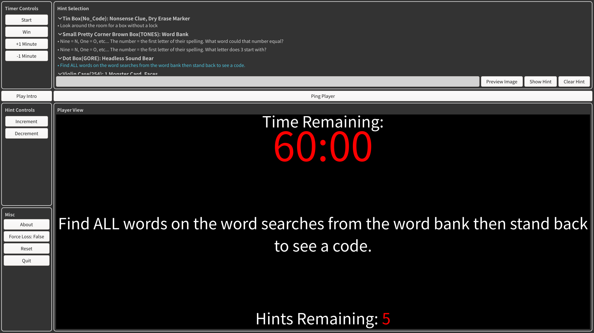
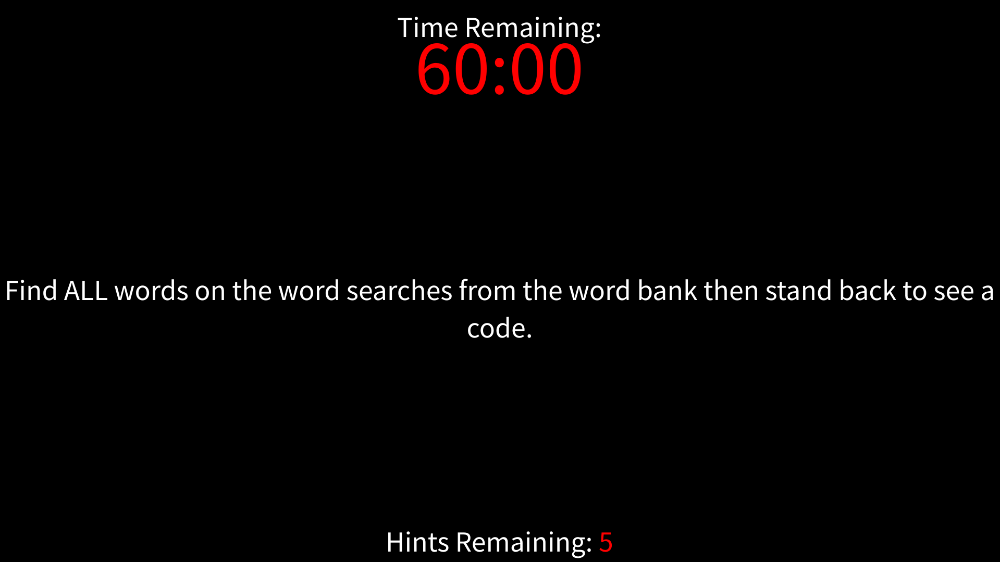

# RoomWare

This is escape room management software.

What it does:
- Displays hints to user
  - Text and images
- Controls the amount of time left
- Controls the remaining hints
- Logs wins and losses
  - If configured, doesn't by default
- Allows an introduction video to be played
- Has a ping player button

This program assumes you have a computer with a screen for the game master to
control the game and another screen inside of the room to display information to the
players.

This program automatically downloads the latest version of hints/config found in
the [rooms](rooms) folder of this repo.

### Sample Pictures

Game master view:


Player view:


## Installing on Windows

Find the `releases` section on the right side of the Github repo. Click on the latest release.
As of writing, the latest release is `v3.4.1`. Once in the releases section, download
`roomware-setup.exe`.

Once running the installer, select which room you would like to install and set a password
for the remote video player webpage.

# Development Usage

This section is for more technical readers who are looking to modify the
source code.

```
roomware <room_name> <optional flag>
```

`<room_name>`: Grabs the configuration for a specific room (typically the one downloaded with the installer)
found in the `rooms` directory.  

`-f, --force`: Force redownloads everything for the specified room  
`-l, --local`: Will download nothing on startup

The typical behavior is to pass no flags and simply run `roomware <room_name>`. These two flags
exist in case something goes horribly wrong or for development reasons.

### Testing the server

If you want to test the server functionality locally and need to use the `\login` route, place a file at
`target/password.txt` with a single line containing the password.

## Building for Windows

```
nix build .#windows-installer
```

This cross compiles the program and packs it, along with the GTK and GStreamer
DLLs it needs, into a single `setup.exe` in `./result`. Copy that one file over
to the Windows machine and run it. It asks which room that machine runs, out of
the folders in `rooms/`, installs into `Program Files` alongside that room's
`config.toml` and `hints.toml`, and adds a RoomWare Start Menu shortcut that
opens with them. Running it again with a different room swaps the room over. It
can be removed again from Add or Remove Programs.

The installer also asks for the password used to log in on RoomWare's web page,
and saves it to `password.txt` in the install directory. When running it again,
leaving the password empty keeps the saved one. Without a `password.txt`, the web
page isn't served.

`nix build .#windows` gives the same build as a plain directory instead, for
running it off a stick without installing. Copy the whole directory over,
keeping its layout, and run `bin\roomware.exe` from inside it. Put a
`password.txt` beside `bin` for the web page.

Those DLLs are MSYS2's Windows builds, pinned in `nix/msys2-packages.json`,
because nixpkgs cannot build GTK for Windows itself. To move to their current
versions, run `nix run .#update-msys2` and build again.

## Configuration

There are two different files used for configuration found in `rooms/<room_name>/`:

- `config.toml`
- `hints.toml`

`config.toml` holds general configuration for the various buttons around the interface. For example,
you want to change the background color of the player's view to black instead of brown. This is
where you can change it.

`hints.toml` holds pre-typed hints for the room read in order they are found in the file.

Paths inside either file, such as a video, a ping sound or a picture hint, are relative to the file
they are written in. A `./picture.png` in `hints.toml` is the picture sitting next to `hints.toml`,
wherever you keep it. Absolute paths work too. (There's even a button to preview the image).

## Other

Link to escape on main image used and resized with imagemagick: https://www.escapeonmain.com/wp-content/uploads/2019/07/escapeonmainfavicon.png
